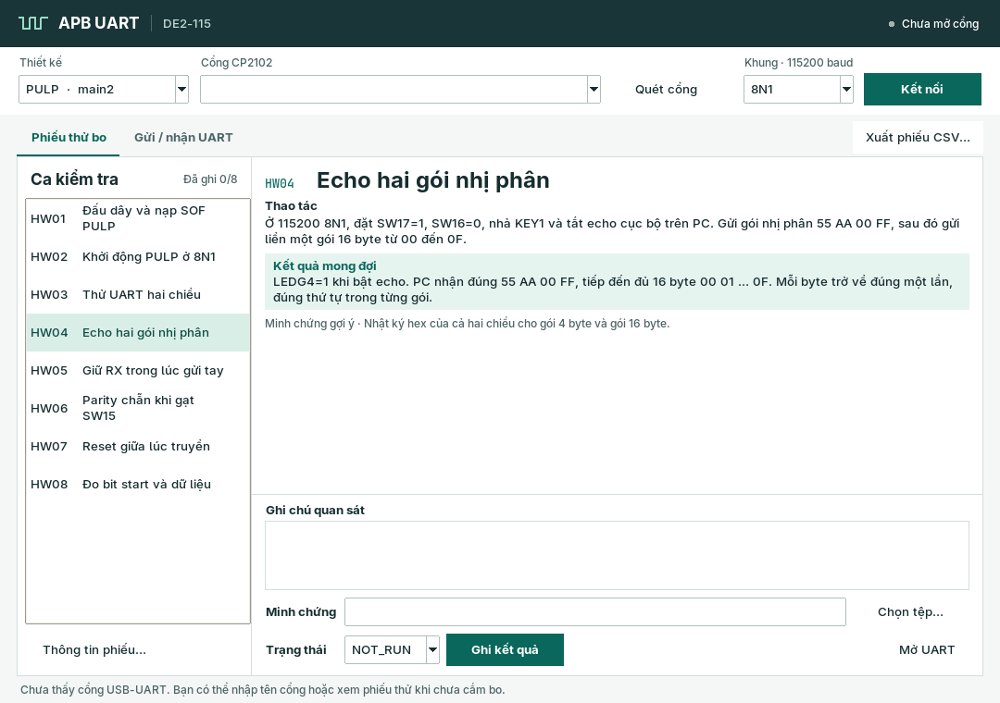

# Bàn thử APB UART

Cửa sổ Python dùng cho cả Windows và Linux. Chọn `TARGET · main` khi đã nạp SOF RC1, hoặc `PULP · main2` cho SOF biên dịch từ lõi PULP. [Chương trình](uart_gui.py)

## Mở cửa sổ

Từ thư mục gốc của dự án, dùng Python 3.11 trở lên với Tk và pySerial 3.5.

**Windows (PowerShell)**

```powershell
py -3 -m pip install pyserial==3.5
py -3 -X utf8 host/uart_gui.py
```

**Linux**

```sh
python3 -m venv .venv
.venv/bin/python -m pip install pyserial==3.5
.venv/bin/python host/uart_gui.py
```

Nếu đã cài pySerial vào `.venv` của dự án, `python3 host/uart_gui.py` cũng mở được cửa sổ. Trên Arch, Python dùng thư viện `tk`. Có thể chọn trước thiết kế bằng `--profile target` hoặc `--profile pulp`. Chỉ định `--port COM7` hoặc `--port /dev/ttyUSB0` để mở ngay một cổng đã biết.

## Phiếu thử bo

Phiếu của TARGET có **14 ca** (HW01–HW14), phiếu PULP có **8 ca** (HW01–HW08). Cùng một mã HW có thể chỉ hai thao tác khác nhau ở hai thiết kế. Chọn đúng thiết kế, rồi chọn một ca để xem **thao tác**, **kết quả mong đợi** và **bằng chứng cần lưu**.

Trong **Thông tin phiếu**, điền người thử, mã bo, mã CP2102/cổng và SHA-256 của SOF. Sau mỗi phép thử, nhập số đo, byte thực nhận hoặc giá trị HEX/LED vào **Ghi chú quan sát**. Chọn tệp ảnh hoặc nhật ký làm minh chứng, chọn trạng thái rồi nhấn **Ghi kết quả**. Mỗi ca bắt đầu ở `NOT_RUN`. Ghi `PASS` khi quan sát đáp ứng đầy đủ tiêu chí, hoặc `FAIL` khi có sai khác.

Nhấn **Xuất phiếu CSV** để lưu kết quả của thiết kế đang chọn. Có thể mở tệp này trong Excel. Ảnh và nhật ký được tham chiếu bằng đường dẫn. Khi nộp báo cáo, gửi kèm các tệp minh chứng.



[Phiếu CSV của nhánh này](../docs/07_FPGA_Board_Acceptance.csv) · [Đấu dây, nạp SOF và thử bo](../docs/05_FPGA_Windows.md)

## Gửi và nhận

Chọn cổng CP2102 rồi nhấn **Kết nối**. Có thể nhập tên COM hoặc đường dẫn thiết bị trực tiếp. Tab **Gửi / nhận UART** cho phép gửi HEX hoặc văn bản UTF-8 và hiển thị TX/RX khi có dữ liệu, kể cả byte do KEY1 phát. Mặc định là 115200 baud, 8N1. Sau khi ngắt cổng, bạn có thể đổi khung cho khớp với công tắc tại lúc reset bo.

Để thử echo, đặt SW16=0, SW17=1 rồi chọn **Thử echo** với gói `55 AA 00 FF`. PC so từng byte và hiển thị `MATCH`, `NO_RX`, `SHORT`, `EXTRA`, `MISMATCH` hoặc `BUSY`. Trước khi gửi, chương trình chờ RX yên 120 ms. Sau khi gửi, nó so các byte nhận trong 1 giây và ghi kết quả vào nhật ký UART. Người thử ghi kết luận riêng cho cả bài trong phiếu. Dùng `--log <đường-dẫn>` để chọn nơi ghi nhật ký JSON Lines.

## Menu dòng lệnh

Trên Windows dùng `py -3 host/uart_menu.py`. Trên Arch dùng `python3 host/uart_linux.py`. Phím `c` chọn cổng, `x` gửi HEX, `t` gửi chữ, `r` nhận byte, `e` thử echo, `f` đổi khung, `h` xem hướng dẫn. Cả hai chương trình nhận `--list` để liệt kê cổng. Mỗi lượt gửi tối đa 1.024 byte. Để gửi CR/LF, nhập `0D 0A` ở chế độ HEX. [Menu Windows](uart_menu.py) · [Menu Arch](uart_linux.py)
